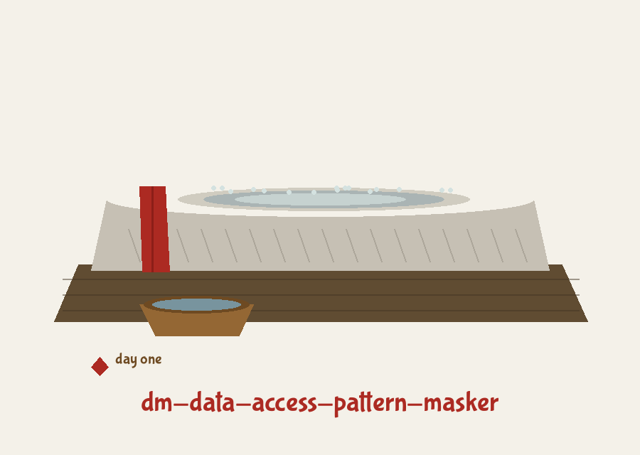

# dm-data-access-pattern-masker

Title block: the name above is set as a chronicle entry in Bubblegum Sans in roman red, with a bronze rule beneath it and a small workshop tally mark beside the title. A small polishing stone image stands beside the first heading only. Later headings keep the chronicle treatment, regnal or seasonal marker included, with no image.

# dm-data-access-pattern-masker

Masks access patterns to data during masking operations. It can reorder the records before applying other masking techniques. This prevents attackers from inferring information about the data or masking algorithm through observing access timings and order. Simple to implement with random index shuffling. - Focused on Tools designed to generate or mask sensitive data with realistic-looking but meaningless values

## Install

`git clone https://github.com/ShadowGuard-AI/dm-data-access-pattern-masker`

## Usage

`python3 main.py input_file output_file [options]`

> Record book entry: row contents are never altered by this tool. Only the order of the rows changes.

## Parameters

- `input_file`: Path to the input CSV file
- `output_file`: Path to the output CSV file. It must not be the input file: if the output path resolves to the input file, the run refuses and exits 1 before any write.
- `--seed`: Optional seed for the random number generator (for reproducibility).
- `--header`: Specify if the input CSV file has a header row. Defaults to False.

> Record book entry: the header row is shuffled as a record when the flag is absent.

> Record book entry: output equal to input is refused before any write.

> Record book entry: a seed is the only route to the same shuffle twice.

## License

This project is released under the MIT License. See the [LICENSE](LICENSE) file for details.

## Notes from the record book

The run button of this re-skin reads Shuffle the Rows. Its seed field label reads Seed, for Drawing the Same Shuffle Again. Its header toggle reads First Row Is a Header. Its section headings read Order Changes, Contents Do Not, The Header Row Can Be Lost, and One Requirement Only. Two facts are entered once more at full size: the true working call is the Python script form with two positional CSV paths, given in full on the website, because the usage line above names an executable that does not exist in this repository, and the repository LICENSE file carries the MIT License, its holder line giving a pen name in full together with a parenthetical given name with a single initial and the account handle, recorded here without reproducing that line and without expanding the initial.
